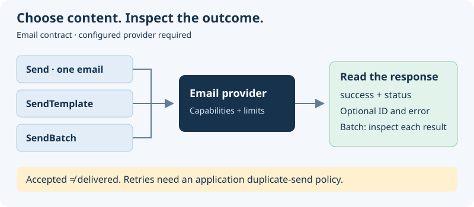

Send transactional messages, templates, and batches through one contract that does not depend on the provider. `@antelopejs/interface-email` defines the request and response types. An implementing module supplies the email provider and its configuration.

## Choose your sending path

| Your task                                          | Start here                                                     |
| -------------------------------------------------- | -------------------------------------------------------------- |
| Send a welcome email or receipt                    | [Send a message](./2.sending-emails.md#the-emailparams-object) |
| Personalize provider-hosted or inline content      | [Template emails](./2.sending-emails.md#template-emails)       |
| Send several messages and inspect partial failures | [Batch sending](./2.sending-emails.md#batch-sending)           |
| Include a document or inline image                 | [Attachments](./3.attachments.md)                              |
| Keep optional features portable                    | [Provider capabilities](#provider-capabilities)                |

{width="480"}

**Before sending.** Configure an implementation with credentials and an authorized sender. This contract alone does not connect an email service. The examples use placeholder recipients and send no mail from this documentation.

## Core concepts

The interface splits email operations into four functions:

| Function          | Purpose                                                        |
| ----------------- | -------------------------------------------------------------- |
| `Send`            | Send a single email with full control over content and options |
| `SendBatch`       | Send multiple emails in a single operation                     |
| `SendTemplate`    | Send an email rendered from a template                         |
| `GetCapabilities` | Query the provider's supported features and limits             |

The sending functions return typed delivery responses. `GetCapabilities` returns feature flags and limits instead. A successful send means that the provider accepted the request. It does not confirm delivery, so read `status` as well.

## Installation

```bash
npm install @antelopejs/interface-email
```

## Email address types

Recipients, senders, and reply-to addresses all accept the `EmailAddress` type. It has two forms: a plain string, or an object with an optional display name.

### String format

Pass an email address directly as a string:

```ts
import type { EmailAddress } from "@antelopejs/interface-email";

const to: EmailAddress = "user@example.com";
```

### Object format with `EmailAddressObject`

Use the object form to add a display name to the address:

```ts
import { EmailAddressObject } from "@antelopejs/interface-email";

const sender: EmailAddressObject = {
  email: "support@myapp.com",
  name: "MyApp Support",
};
```

### The `EmailAddress` union type

`EmailAddress` is the union of both forms. Every address field in the interface accepts either form:

```ts
import { EmailAddress } from "@antelopejs/interface-email";

// Both are valid EmailAddress values
const simple: EmailAddress = "hello@example.com";
const detailed: EmailAddress = { email: "hello@example.com", name: "Hello" };
```

The `to`, `replyTo`, `cc`, and `bcc` fields also accept an array of `EmailAddress`, and the array can mix both forms. `from` takes a single address.

```ts
import { Send } from "@antelopejs/interface-email";

await Send({
  to: ["alice@example.com", { email: "bob@example.com", name: "Bob" }],
  subject: "Team Update",
  text: "Here is the latest update.",
});
```

## Provider capabilities

Providers differ in what they support. `GetCapabilities` returns a `ProviderCapabilities` object with the provider's name, limits, and supported features.

```ts
import { GetCapabilities } from "@antelopejs/interface-email";

const capabilities = await GetCapabilities();

console.log(capabilities.name); // "nodemailer" with @antelopejs/nodemailer
console.log(capabilities.features.batch); // true or false
console.log(capabilities.features.scheduling); // true or false
console.log(capabilities.maxRecipients); // undefined when the provider reports no limit
```

The `ProviderFeatures` object has these flags:

| Feature             | Description                                                                                  |
| ------------------- | -------------------------------------------------------------------------------------------- |
| `batch`             | Supports sending multiple emails in one request                                              |
| `templates`         | `SendTemplate` works for at least inline templates                                           |
| `providerTemplates` | `SendTemplate` accepts a `ProviderTemplate` (a template stored by the provider, named by id) |
| `scheduling`        | Supports delayed email delivery                                                              |
| `openTracking`      | Tracks when recipients open emails                                                           |
| `clickTracking`     | Tracks when recipients click links                                                           |
| `inlineAttachments` | Supports inline, embedded images                                                             |
| `tags`              | Supports email tagging for analytics                                                         |
| `metadata`          | Supports custom metadata on emails                                                           |
| `priority`          | Supports email priority levels                                                               |

Check `providerTemplates` before you pass a `ProviderTemplate`: `templates` alone promises only inline templates. `@antelopejs/nodemailer` renders inline templates only, so it reports `providerTemplates` as `false` ([AntelopeJS/nodemailer#45](https://github.com/AntelopeJS/nodemailer/issues/45)). A flag is the module's own claim. `@antelopejs/brevo` reports `openTracking`, `clickTracking` and `inlineAttachments` as `true` but applies none of them ([AntelopeJS/brevo#44](https://github.com/AntelopeJS/brevo/issues/44)).

Each implementing module decides which fields it applies. A module can drop a field that it does not apply and still report the send as successful. To keep your code portable, check the capabilities before you use an optional feature:

```ts
import {
  GetCapabilities,
  Send,
  type EmailParams,
} from "@antelopejs/interface-email";

const caps = await GetCapabilities();

const params: EmailParams = {
  to: "user@example.com",
  subject: "Hello",
  html: "<p>Welcome!</p>",
};

if (caps.features.scheduling) {
  params.schedule = { sendAt: new Date(Date.now() + 60 * 60 * 1000) };
}

await Send(params);
```

The capability limits `maxRecipients`, `maxBatchSize`, `maxAttachmentSize`, and `maxEmailSize` are optional. Size limits are in bytes. An absent limit does not mean that capacity is unlimited, so check your provider configuration. `version` is optional provider metadata.

## Next steps

- [Sending emails](./2.sending-emails.md) lists every email parameter and covers templates, batch sending, and delivery responses.
- [Attachments](./3.attachments.md) shows how to attach files from buffers, base64 strings, file paths, or URLs.
