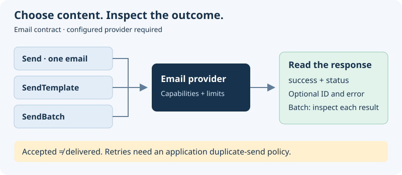

# Introduction

Send transactional messages, templates, and batches through one provider-neutral contract. `@antelopejs/interface-email` defines the request and response types; an implementing module supplies the email provider and its configuration.

## Choose your sending path

| Your task                                          | Start here                                                     |
| -------------------------------------------------- | -------------------------------------------------------------- |
| Send a welcome email or receipt                    | [Send a message](./2.sending-emails.md#the-emailparams-object) |
| Personalize provider-hosted or inline content      | [Template emails](./2.sending-emails.md#template-emails)       |
| Send several messages and inspect partial failures | [Batch sending](./2.sending-emails.md#batch-sending)           |
| Include a document or inline image                 | [Attachments](./3.attachments.md)                              |
| Keep optional features portable                    | [Provider capabilities](#provider-capabilities)                |



**Before sending:** configure an implementation with credentials and an authorized sender. Installing this contract alone does not connect an email service. Examples use placeholder recipients and do not send mail from this documentation.

## Core Concepts

The interface separates email operations into four functions:

| Function          | Purpose                                                        |
| ----------------- | -------------------------------------------------------------- |
| `Send`            | Send a single email with full control over content and options |
| `SendBatch`       | Send multiple emails in a single operation                     |
| `SendTemplate`    | Send an email rendered from a template                         |
| `GetCapabilities` | Query the provider's supported features and limits             |

The sending functions return typed delivery responses. `GetCapabilities` returns feature flags and limits instead. A successful send means the provider accepted the request; inspect `status` rather than treating acceptance as confirmed delivery.

## Installation

```bash
npm install @antelopejs/interface-email
```

## Email Address Types

Recipients, senders, and reply-to addresses all accept the `EmailAddress` type. This type supports two formats: a plain string or an object with an optional display name.

### String format

Pass an email address directly as a string:

```ts
import type { EmailAddress } from "@antelopejs/interface-email";

const to: EmailAddress = "user@example.com";
```

### Object format with `EmailAddressObject`

Use the object format to include a display name alongside the address:

```ts
import { EmailAddressObject } from "@antelopejs/interface-email";

const sender: EmailAddressObject = {
  email: "support@myapp.com",
  name: "MyApp Support",
};
```

### The `EmailAddress` union type

The `EmailAddress` type is a union of both formats. All address fields in the interface accept either form:

```ts
import { EmailAddress } from "@antelopejs/interface-email";

// Both are valid EmailAddress values
const simple: EmailAddress = "hello@example.com";
const detailed: EmailAddress = { email: "hello@example.com", name: "Hello" };
```

Fields like `to`, `cc`, and `bcc` also accept arrays of `EmailAddress`, so you can mix formats freely:

```ts
import { Send } from "@antelopejs/interface-email";

await Send({
  to: ["alice@example.com", { email: "bob@example.com", name: "Bob" }],
  subject: "Team Update",
  text: "Here is the latest update.",
});
```

## Provider Capabilities

Not all email providers support every feature. The `GetCapabilities` function returns a `ProviderCapabilities` object describing the provider's name, limits, and supported features.

```ts
import { GetCapabilities } from "@antelopejs/interface-email";

const capabilities = await GetCapabilities();

console.log(capabilities.name); // e.g., "sendgrid"
console.log(capabilities.features.batch); // true or false
console.log(capabilities.features.scheduling); // true or false
console.log(capabilities.maxRecipients); // e.g., 1000
```

The `ProviderFeatures` object includes the following flags:

| Feature             | Description                                     |
| ------------------- | ----------------------------------------------- |
| `batch`             | Supports sending multiple emails in one request |
| `templates`         | Supports provider-hosted templates              |
| `scheduling`        | Supports delayed email delivery                 |
| `openTracking`      | Tracks when recipients open emails              |
| `clickTracking`     | Tracks when recipients click links              |
| `inlineAttachments` | Supports inline/embedded images                 |
| `tags`              | Supports email tagging for analytics            |
| `metadata`          | Supports custom metadata on emails              |
| `priority`          | Supports email priority levels                  |

Check capabilities before using optional features to ensure your code works across providers:

```ts
import {
  GetCapabilities,
  Send,
  type EmailParams,
} from "@antelopejs/interface-email";

const caps = await GetCapabilities();

const params: EmailParams = {
  to: "user@example.com",
  subject: "Hello",
  html: "<p>Welcome!</p>",
};

if (caps.features.scheduling) {
  params.schedule = { sendAt: new Date(Date.now() + 60 * 60 * 1000) };
}

await Send(params);
```

Capability limits are optional: `maxRecipients`, `maxBatchSize`, `maxAttachmentSize`, and `maxEmailSize` may be absent. Size limits are in bytes. An absent limit is not a promise of unlimited capacity; check your provider configuration. `version` is optional provider metadata.

## Next Steps

- [Sending Emails](./2.sending-emails.md) -- Learn about all email parameters, templates, batch sending, and delivery responses.
- [Attachments](./3.attachments.md) -- Attach files using buffers, base64, file paths, or URLs.
